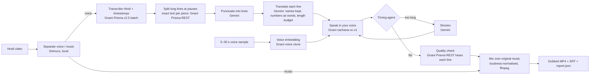

# Ekswar: one voice, every Indian language

> 📄 **1-page solution pitch: [PITCH.md](PITCH.md)** · 📝 Full write-up: [docs/SUBMISSION.md](docs/SUBMISSION.md)

Ekswar dubs a short **Hindi** video into **Tamil, Bengali or Marathi** in the **creator's own cloned voice**. Each dubbed line is timed to the moment it was originally spoken, the background music is kept, and you also get subtitles and a metrics report.

> Entry for the **Great Indian AI Internship Challenge by Gnani AI** (Nov 2026).
> Built on **Gnani Prisma v2.5** (speech-to-text) and **Gnani voice cloning `vachana-vc-v1`**.

---

## Why

A Hindi creator reaches only part of India. Subtitles are often skipped, human dubbing is expensive and replaces the creator's voice, and simple AI dubbing drifts out of sync, because a translated sentence rarely takes the same time to say as the original.

Ekswar keeps **the creator's voice** and keeps **the timing**.

## The core idea: a timing agent

Every dubbed line is spoken, **measured**, and adjusted until it fits the time the original line took:

```
budget = original slot + half of the pause after it

fits, but < 75 % of the original time     → ask Gemini once for a fuller, natural line (same meaning, no new facts); keep it only if it still fits
fits, but much shorter than the original  → slow down slightly (never below 0.85×)
fits                                      → keep it, pad with silence
up to 15 % too long                       → speed up (pitch unchanged)
more than 15 % too long                   → Gemini rewrites it shorter → speak again → re-check (up to 3×)
still too long                            → speed up to 1.25× on the shortest version, else FLAG it
```
Speech is never cut mid-word. Every decision is recorded in `report.json` and shown on the web page.

## How it works



| Step | Tool | Runs |
|---|---|---|
| Voice/music separation | Demucs (`htdemucs`, two stems) | local |
| Hindi transcription with timestamps | **Gnani Prisma v2.5, Batch API** | Gnani |
| Split long lines at the speaker's pauses (exact text per piece) | ffmpeg silence detection + **Gnani Prisma REST** | local + Gnani |
| Punctuation, translation, shortening | Google Gemini (with automatic backup models) | Google |
| Voice cloning + speech | **Gnani voice clone embedding + `vachana-vc-v1`** | Gnani |
| Timing agent | `src/timing.py` + ffmpeg `atempo` / `apad` | local |
| Quality check of each dubbed line | **Gnani Prisma REST** + character similarity (rapidfuzz) | Gnani + local |
| Mix, mux (video stream copied, not re-encoded), subtitles | ffmpeg, numpy | local |

## Results (our own 2-minute test video)

117 s Hindi video of a team member (their own voice and face), soft background music, dubbed into all three languages:

| Language | Lines | Fit | Fuller line | Slowed | Sped up | Rewritten | Failed | Voice fills original speaking time | Quality check avg. |
|---|---|---|---|---|---|---|---|---|---|
| Tamil | 21 | 18 | 10 | 15 | 2 | 1 | 0 | **90 %** | 97.7 % |
| Bengali | 21 | 21 | 15 | 18 | 0 | 0 | 0 | **89 %** | 95.1 % |
| Marathi | 21 | 21 | 14 | 16 | 0 | 0 | 0 | **92 %** | 98.3 % |

Before the "fuller line" step and the 0.85× limit, the voice filled only 69–78 % of the original speaking time.

"Quality check" = Gnani's own speech recognition listened to every dubbed line and compared it with the intended text. It measures **intelligibility**, not native-speaker quality.

## Honest limits

- **No lip-sync.** Ekswar matches *when* the voice speaks, not *how the lips move*. The mouth in the video is unchanged.
- **Translations have not been checked by native Tamil/Bengali speakers.** Marathi reads naturally to us.
- **Cloned voice quality** was judged "okay" by the team in all three languages. It speaks faster than the original speaker; with fuller lines and slight slow-down the voice now fills about 89–92 % of the original speaking time, but small silences remain.
- **Fuller lines** are rephrased by an LLM to fill time. They keep the meaning, but are slightly wordier than a strict translation.
- **Scope:** Hindi source only, one speaker, videos up to 3 minutes. Other directions (e.g. Tamil → Hindi) are future work.
- **Free-tier limits:** Gemini daily/per-minute quotas and occasional Gnani 504s are handled (backup models, retries, "not checked" marks), but can slow a run.
- Every output is labelled **AI-dubbed**. Clone only your own voice or a voice you have permission to use.

## Run it

**Requirements:** Windows/macOS/Linux, Python 3.13, ffmpeg on PATH, a Gnani API key and a Gemini API key.

```bash
git clone https://github.com/gokubasumatary-web/Ekswar.git
cd Ekswar
python -m venv .venv
.venv\Scripts\python -m pip install -r requirements.txt     # macOS/Linux: .venv/bin/python
copy .env.example .env                                      # add your keys (never commit .env)
.venv\Scripts\python -m src.config                           # checks the setup, never prints keys
```

**Web page** (local only: it uses your API keys):
```bash
.venv\Scripts\streamlit run app.py        # http://localhost:8501
```

**Command line:**
```bash
.venv\Scripts\python cli.py --video my_video.mp4 --lang ta-IN,bn-IN,mr-IN --ref my_voice.mp3 --names "Your Name"
```
Outputs: `outputs/runs/<video>/<video>.<lang>.mp4`, `.srt`, and `report.json`.

**Tests** (offline, no API calls): `.venv\Scripts\python -m pytest -q` → 164 tests.

## Project layout

```
cli.py, app.py               command line and web page (both call src/pipeline.py)
src/pipeline.py              runs all steps, writes report.json
src/gnani.py                 Gnani client: batch STT, REST STT, voice clone embedding, cloned TTS
src/llm.py                   the only Gemini client (cache, retries, backup models, quota handling)
src/separate.py              ffmpeg + Demucs
src/segment.py, units.py     split long lines at pauses, build timed lines
src/translate.py             translation + shortening prompts and checks
src/timing.py                the timing agent
src/qa.py, mix.py            quality check, final mix + subtitles
docs/stages/                 how each part was built and tested
NOTES.md                     every place the real APIs differed from their docs
```

Design choices that matter: **every API result is cached** (re-runs cost no credits); **one failed line never stops a run**; **key / credit problems stop it immediately**; timing decisions are **pure functions** tested without any network.

## Team

**Guthal Basumatary** and **Ananya** contributed **equally** to Ekswar. They worked together on the idea, the design, building and testing the pipeline and the web page, the voice tests, the demo and the documentation.

Development was assisted by **Claude Code** (an AI coding assistant).

## Future work

**Today:** Hindi in, Tamil/Bengali/Marathi out, one speaker, up to 3 minutes, timing sync only. Ekswar **cannot** yet dub a regional-language video into Hindi or English.

- **Lip-sync:** an optional, experimental step that redraws the mouth (needs a GPU).
- **More languages:** add Telugu, Kannada, Malayalam, Gujarati, Punjabi and English (Gnani's voice models list all 10).
- **Any direction:** regional → Hindi/English (e.g. Tamil → Hindi, Bengali → English) and between any two Indian languages.
- **Several speakers**, each in their own cloned voice. **Longer videos** (over 3 minutes).
- **Native-speaker review:** edit one line on the web page and re-render only that line.

Full plan: [docs/FUTURE_PLAN.md](docs/FUTURE_PLAN.md).
